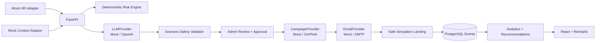

# Architecture

## Trust boundaries
The backend is the policy enforcement point. LLM output is untrusted until validated. Campaign launch is impossible before approval. External providers are adapters so their failure does not collapse core state. Synthetic HR/context data is used in the prototype. The simulation endpoint stores only event facts and safe metadata.

## Risk model
Score inputs are transparent weighted points: department exposure, privilege (`level × 7`), access sensitivity (`level × 6`), social exposure (`level × 5`), and capped previous risky interaction points. The sum is normalized by `1.18` and capped at 100. Levels: low <35, medium <65, high <85, otherwise critical.

## Evolution
A `RealHRAdapter` can replace the mock adapter without changing services. Provider interfaces similarly isolate LLM, campaign, and email dependencies. Multi-tenancy would add tenant IDs, tenant-scoped authorization, row-level isolation, per-tenant secrets, and tenant-specific audit policies.
