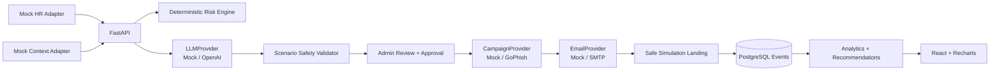

# Architecture

## Trust boundaries
The backend is the policy enforcement point. LLM output is untrusted until validated. Campaign launch is impossible before approval. External providers are adapters so their failure does not collapse core state. Synthetic HR/context data is used in the prototype. The simulation endpoint stores only event facts and safe metadata.

## HR data layer (adapter pattern)
Employees enter the system through an `HRAdapter` (`app/adapters/hr.py`). `MockHRAdapter` serves a synthetic directory (also used by the seed), and `RestHRAdapter` is a read-only stub for a future OAuth-scoped, audited HR integration — selected by `HR_PROVIDER`. `sync_from_hr` upserts records by `external_id` then email (idempotent), stamping each employee with its `source` and `external_id`, then recalculates risk and ensures context. `GET /hr/source` previews the raw source; `POST /hr/sync` performs the import.

## Risk model
Score inputs are transparent weighted points: department exposure, role seniority (from the role title), access privilege (`level × 5`), data sensitivity (`level × 6`), social exposure (`level × 5`), and capped previous risky-interaction points. The sum is normalized by `1.26` and capped at 100. Levels: low <35, medium <65, high <85, otherwise critical. Language is an employee attribute that drives content generation (multilingual output), not the score.

## Evolution
Enabling `RestHRAdapter` (`HR_PROVIDER=rest`) replaces the mock source without changing services. Provider interfaces similarly isolate LLM, campaign, and email dependencies. Multi-tenancy would add tenant IDs, tenant-scoped authorization, row-level isolation, per-tenant secrets, and tenant-specific audit policies.
