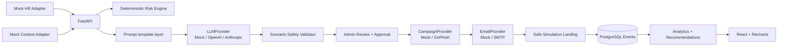

# Architecture

## Trust boundaries
The backend is the policy enforcement point. LLM output is untrusted until validated. Campaign launch is impossible before approval. External providers are adapters so their failure does not collapse core state. Synthetic HR/context data is used in the prototype. The simulation endpoint stores only event facts and safe metadata.

## HR data layer (adapter pattern)
Employees enter the system through an `HRAdapter` (`app/adapters/hr.py`). `MockHRAdapter` serves a synthetic directory (also used by the seed), and `RestHRAdapter` is a read-only stub for a future OAuth-scoped, audited HR integration — selected by `HR_PROVIDER`. `sync_from_hr` upserts records by `external_id` then email (idempotent), stamping each employee with its `source` and `external_id`, then recalculates risk and ensures context. `GET /hr/source` previews the raw source; `POST /hr/sync` performs the import.

## Prompt engineering & LLM providers
Scenario text comes from a single template layer (`app/llm/prompts.py`). `render_scenario` deterministically builds a scenario from department themes, difficulty (tone/red-flag density), and language; `build_prompt` assembles the system+user prompts a real model receives with the same intent and safety constraints. Providers (`app/llm/providers.py`) all consume that layer: `MockLLMProvider` (offline default), `OpenAIProvider` (GPT, structured JSON), and `AnthropicProvider` (Claude, Messages API), chosen by `LLM_PROVIDER`. Output is multilingual (Azerbaijani/English) and easily extended with more languages.

## Risk model
The profile score (0-100) is a weighted sum of five transparent, normalized dimensions whose weights sum to 100: role & privilege (30), department exposure (22), data sensitivity (20), social exposure (18), and **language exposure (10)** — directly realizing the plan's role/department/language attributes. Prior risky behaviour adds an adaptive modifier (capped at 12). Each contribution is returned with its weight, points, and a human-readable detail so the profile is explainable. Levels: low <35, medium <65, high <85, otherwise critical.

## Evolution
Enabling `RestHRAdapter` (`HR_PROVIDER=rest`) replaces the mock source without changing services. Provider interfaces similarly isolate LLM, campaign, and email dependencies. Multi-tenancy would add tenant IDs, tenant-scoped authorization, row-level isolation, per-tenant secrets, and tenant-specific audit policies.
